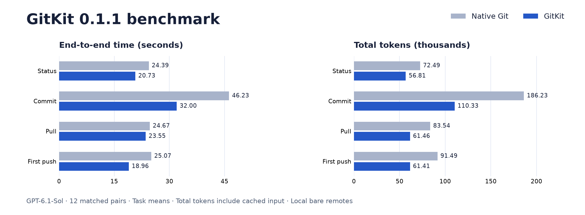

# GitKit

[简体中文](README.zh-CN.md) · [Releases](https://github.com/IweirdoI/gitkit/releases) · [Issues](https://github.com/IweirdoI/gitkit/issues) · [MIT](LICENSE)

A Git CLI for people and a stdio MCP server for agents. Both share one TypeScript engine for inspecting, committing, pulling and pushing changes. GitHub and Gitee also support creating and updating same-repository pull requests.

## Install

Requires **Node.js 22+** and **Git 2.39+**. Install [Git LFS](https://git-lfs.com/) for large-file workflows.

```sh
npm install -g https://github.com/IweirdoI/gitkit/releases/download/v0.1.1/gitkit-agent-0.1.1.tgz
gitkit --help
```

The npm package name is `gitkit-agent`. Once the version is available on npm, run `npx gitkit-agent@0.1.1 --help` or install it with `npm install -g gitkit-agent@0.1.1`. [Check npm availability](https://www.npmjs.com/package/gitkit-agent).

## Use it in a repository

```sh
gitkit status --json
gitkit diff staged
gitkit commit --paths src --dry-run
gitkit pull --ff-only
gitkit push --pr --base main --dry-run
```

Run from your repository or pass `--cwd <repository>`. Each command has `--help`. Remove `--dry-run` when you are ready to execute. Git uses your configured HTTPS credential helper or SSH agent. PR operations read `GITHUB_TOKEN` or `GH_TOKEN` on GitHub, or `GITEE_TOKEN` on Gitee.

## Set up an agent

Send [this repository URL](https://github.com/IweirdoI/gitkit) and the following prompt to an agent with terminal and MCP configuration access.

> Read README.md and docs/agents.en.md here. Install the pinned GitKit version using the documented command, register its stdio MCP server for my current Git repository, and verify it with the read-only status tool. Follow my client's approval rules.

Codex, Claude Code/Desktop, Cursor and DeepSeek Harness support stdio. DeepSeek Harness also has a native plugin. ChatGPT custom apps can connect through a Secure MCP Tunnel where available. [Client-specific setup and upgrade instructions](docs/agents.en.md).

## Uninstall

Remove the MCP entry from the client, then uninstall the CLI. For Codex:

```sh
codex mcp remove gitkit
npm uninstall -g gitkit-agent
```

For the DeepSeek Harness native plugin, use `dsh plugin --profile web remove gitkit-agent` with your profile name. [Removal by client](docs/agents.en.md).

## Benchmark



GitKit 0.1.1 averaged **6.28 s faster (20.87%)** and **35,933 fewer total tokens (33.14%)** per task in 12 paired GPT-6.1-Sol trials on Windows. Both groups passed 12/12 repository checks. GitKit was faster in 11 pairs and used fewer total tokens in all 12. Uncached input fell **17.90%** overall. Pull and push used local bare remotes. [Method and reproduction](bench/README.en.md) · [Sanitized measurements](bench/gitkit-0.1.1-full-rerun.json).

## Contribute

Run `npm ci`, `npm test`, and `npm pack` from a clone. Source lives in `src/`, tests in `test/`, and experiments in `bench/`. [Contributing](CONTRIBUTING.md) · [Recovery](docs/recovery.en.md) · [Git attributes template](templates/.gitattributes) · [Private security reporting](SECURITY.md).
