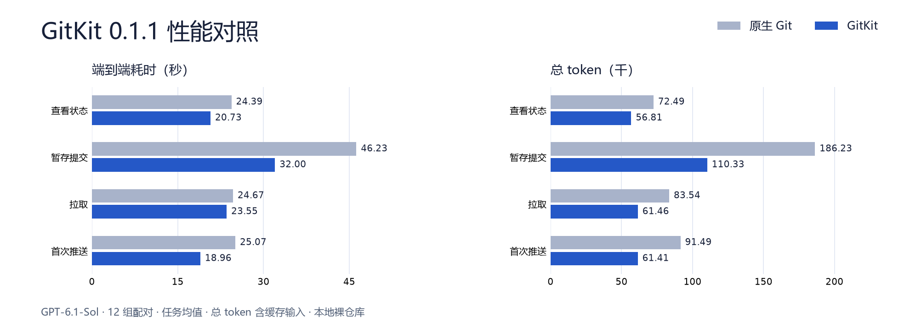

# GitKit

[English](README.md) · [发行版本](https://github.com/IweirdoI/gitkit/releases) · [反馈问题](https://github.com/IweirdoI/gitkit/issues) · [MIT 许可证](LICENSE)

GitKit 为人提供 Git 命令行，为 Agent 提供 stdio MCP 工具。两者共享 TypeScript 核心，可查看改动、提交、拉取、推送，并在 GitHub 或 Gitee 创建、更新同仓库 PR。

## 安装

需要 **Node.js 22+**、**Git 2.39+**。管理大文件时安装 [Git LFS](https://git-lfs.com/)。

```sh
npm install -g https://github.com/IweirdoI/gitkit/releases/download/v0.1.2/gitkit-agent-0.1.2.tgz
gitkit --help
```

npm 包名是 `gitkit-agent`。版本在 npm 可用后，可用 `npx gitkit-agent@0.1.2 --help` 直接运行，或用 `npm install -g gitkit-agent@0.1.2` 持久安装。[查看 npm 发布状态](https://www.npmjs.com/package/gitkit-agent)。

## 基本使用

```sh
gitkit status --json
gitkit diff staged
gitkit commit --paths src --dry-run
gitkit pull --ff-only
gitkit push --pr --base main --dry-run
```

在目标仓库执行，或传 `--cwd <仓库路径>`。每个命令支持 `--help`。预演确认后，去掉 `--dry-run` 执行。Git 传输使用配置好的 HTTPS 凭据助手或 SSH agent。PR 通过环境变量读取令牌，GitHub 用 `GITHUB_TOKEN` 或 `GH_TOKEN`，Gitee 用 `GITEE_TOKEN`。

## 让 Agent 安装

把[仓库网址](https://github.com/IweirdoI/gitkit)和这段话发给有终端及 MCP 配置权限的 Agent。

> 读取本仓库的 README.zh-CN.md 和 docs/agents.md。按文档安装指定版本，为当前 Git 仓库注册 GitKit stdio MCP，并用只读 status 验证。遵循客户端已有审批设置。

Codex、Claude Code/Desktop、Cursor、DeepSeek Harness 支持 stdio。DeepSeek Harness 也有原生插件。网页版 ChatGPT 可在受支持的工作区通过 Secure MCP Tunnel 接入。[各客户端配置与更新](docs/agents.md)。

## 卸载

先移除 Agent 的 MCP 注册，再卸载全局 CLI。以 Codex 为例：

```sh
codex mcp remove gitkit
npm uninstall -g gitkit-agent
```

DeepSeek Harness 原生插件用 `dsh plugin --profile web remove gitkit-agent`，其中 `web` 换成安装时的 profile。[各客户端卸载方法](docs/agents.md)。

## 实测对照



用 GPT-6.1-Sol 在 Windows 做了 12 组配对。GitKit 0.1.1 每次任务**平均省 6.28 秒（20.87%）和 35,933 个总 token（33.14%）**。两组都通过 12/12 次仓库校验。GitKit 在 11 组更快，12 组总 token 更少。未缓存输入 token 整体减少 **17.90%**。拉取和推送使用本地裸仓库。[实验口径与复跑](bench/README.md) · [清洗后的逐次数据](bench/gitkit-0.1.1-full-rerun.json)。

## 参与开发

克隆后运行 `npm ci`、`npm test` 和 `npm pack`。源码在 `src/`，测试在 `test/`，实验在 `bench/`。[提交 Issue 与 PR](CONTRIBUTING.md) · [错误分类与恢复](docs/recovery.md) · [Git 属性模板](templates/.gitattributes) · [私下报告漏洞](SECURITY.md)。
